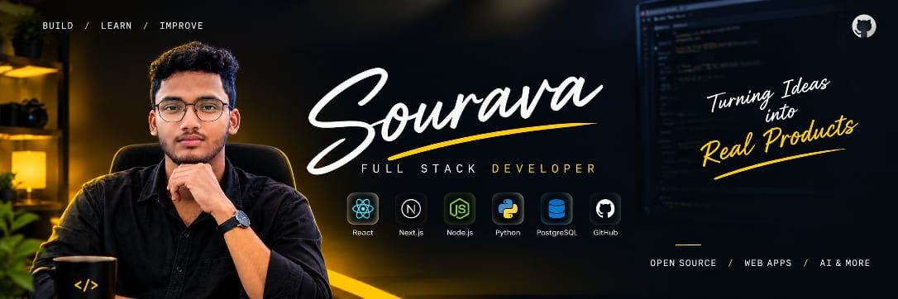
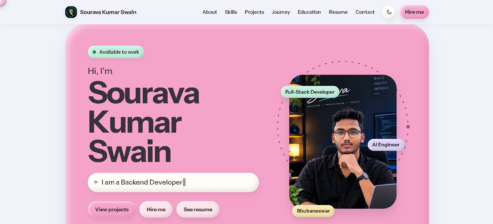

<h1 align="center">👋 Hi, I'm Sourava Kumar Swain</h1>

<h3 align="center">
💻 CSE Student | 🌐 Web Developer | 🚀 Creative Project Builder
</h3><p align="center">
  
</p><p align="center">
  <a href="https://sourava-kumar-swain.vercel.app">
    
  </a>
  
</p>

<p align="center">
  
</p>

# 🧑‍💻 About Me

- 🎓 CSE Student at Goonmesar Engineering College, Bhubaneswar
- 💻 Interested in web development and software development
- 🌐 Building websites using HTML, CSS and JavaScript
- 🚀 Creating interactive, creative and responsive web projects
- 🧠 Always learning new technologies and improving my coding skills
- 📍 Odisha, India

---

# 🚀 My Portfolio

Explore my personal portfolio website to learn more about me and my work.

🌐 Live Website:
https://sourava-kumar-swain.vercel.app

<p align="center">
  
</p>
---

### 💻 Languages

<p>

</p>

## 🎨 Frontend

<p>

</p>

## ⚙️ Backend

<p>

</p>

## 🗄 Database

<p>

</p>

## 🛠 Tools

<p>

</p>


# 🌟 Featured Projects

🎮 1. Webcam Hand Control Puzzle

An interactive web project focused on webcam-based hand-control gameplay.

- 🎥 Webcam interaction
- 🖐️ Hand-control experience
- 🌐 Browser-based project

Live Demo:
https://webcam-handcontrol-puzzle.netlify.app

---

🧪 2. Periodic Table Animation

An interactive periodic table project featuring animated elements and a visual learning experience.

- ⚛️ Periodic table visualization
- ✨ Animated interface
- 📱 Web-based experience

Live Demo:
https://periodic-table-animation.netlify.app

---

🧱 3. Tower Blocker

A browser-based game project with an interactive gameplay experience.

- 🎮 Interactive gameplay
- 🧩 Game-focused design
- 🌐 Play in your browser

Live Demo:
https://tower-blocker.netlify.app

---

💰 4. Udhaar Desk

A web application project for exploring and managing udhaar-related records.

Live Demo:
https://udhaar-desk.vercel.app

---

# 📊 GitHub Statistics

<p align="center">
  
</p><p align="center">
  
</p><p align="center">
  
</p>---

# 🌐 Connect With Me

<p align="left">

<a href="mailto:souravkumarswain3333@gmail.com">

</a>

<a href="https://github.com/sourava-coder">

</a>

<a href="https://www.instagram.com/still_sourav_.99">

</a>

</p>

---

# 🐍 Contribution Snake

<p align="center">
  
</p>

---

# ⚡ Fun Fact

```javascript
while(!success){
   learn();
   build();
   improve();
}
```

<p align="center">
  <b>🚀 Learning Every Day • Building New Ideas • Growing Through Code</b>
</p>---

<p align="center">
  ⭐ Thanks for visiting my GitHub profile!
</p>
